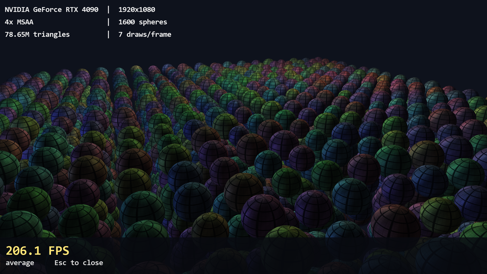

# DirectBench

Welcome to my Managed Direct3D 9 GPU benchmark for Windows. It draws a hardware-instanced field of tessellated spheres with a Shader Model 3.0 Blinn-Phong effect.



This program compiles for x86 only but runs on x64 via Windows on Windows.

## Why Did I Use Managed DirectX, an Ancient Graphics Framework?

I like it here! 😊 Life was better when Microsoft had a managed graphics API (pre-Unity, which is "scripted" and not as fun).

## Requirements

- Windows 
- .NET Framework 4.8.1
- A GPU with Shader Model 3.0 and hardware vertex processing
- To **build**: Visual Studio with the .NET Framework 4.8.1 targeting pack

You do **not** need the DirectX SDK or the DirectX End-User Runtime. 

## Build

Open `DirectBench.sln` and build the x86 platform (Release or Debug), or:

```
msbuild DirectBench.sln /p:Configuration=Release /p:Platform=x86
```

The output is `bin\x86\Release\DirectBench.exe`.

The Microsoft DirectX files are not stored in this repo. The first build runs [`scripts/Get-ManagedDirectX.ps1`](scripts/Get-ManagedDirectX.ps1), which downloads Microsoft's DirectX End-User Runtime (June 2010) from `download.microsoft.com` (~96 MB, SHA-256 verified) and extracts the files below into `lib/MDX`. Later builds reuse them. In Visual Studio, references show as unresolved until that first build.

## Run

Launch `DirectBench.exe` with no arguments to pick an adapter. ENTER finishes a run; ESCAPE exits.

```
DirectBench.exe --help
DirectBench.exe --list
DirectBench.exe --adapter 0 --seconds 10
```

## Dependencies fetched at build time

| File in `lib/MDX` | Why it is needed |
| --- | --- |
| `Microsoft.DirectX.dll` | Core MDX types (`Vector3`, `Matrix`, …), version 1.0.2902.0 |
| `Microsoft.DirectX.Direct3D.dll` | Managed Direct3D 9, version 1.0.2902.0 |
| `Microsoft.DirectX.Direct3DX.dll` | D3DX (effects, font, sprite, texture loader), version 1.0.2911.0 |
| `*.xml` | Microsoft's IntelliSense docs for those assemblies (not shipped) |
| `d3dx9_30.dll` | Native D3DX9 (32-bit) imported by Direct3DX |

`Microsoft.VisualC` (for MDX's `IsConstModifier`) comes from the .NET Framework targeting pack.

## License

DirectBench source is public domain ([The Unlicense](LICENSE)).

The Microsoft DirectX components are Copyright Microsoft Corporation and are not covered by that dedication. See [THIRD-PARTY-NOTICES.txt](THIRD-PARTY-NOTICES.txt).
